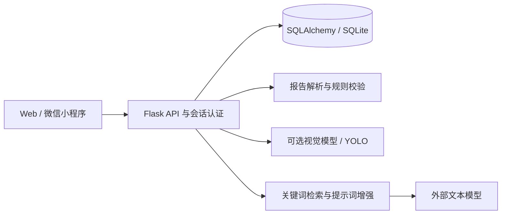

# 益食安康

面向糖尿病饮食管理场景的全栈实践项目：上传报告、提取健康指标、识别现有食材、生成食谱，并记录日常指标。前端包含 Flask Web 页面和微信小程序源码。

**值得查看的工程实践：** 报告结构化解析、规则与生成模型分工、JWT 与会话认证、多端接口、适老化界面，以及基于具体缺陷补充的回归测试。

此版本是用于代码交流与作品展示的源码快照，不包含真实健康报告、用户数据库、训练照片、模型权重或学校服务器配置。功能供学习与演示，不构成医疗诊断或个体饮食处方。

## 功能与实现

| 模块 | 当前实现 |
|---|---|
| 报告解析 | PDF/图片文本处理，规则提取指标与时点信息 |
| 食材识别 | 可配置的云端视觉接口，本地 YOLO 为可选兜底 |
| 食谱生成 | 根据健康场景进行关键词匹配与提示词增强，再调用文本模型 |
| 健康记录 | 指标记录、趋势图、每日血糖记录与体重/BMI |
| 食品查询 | 本地食品资料、营养换算，外部资料查询作为可选能力 |
| 界面 | 大字调节、对比度与系统偏好适配，Web 与小程序入口 |

当前检索增强模块没有运行 FAISS 向量检索。自训 YOLO 属于实验，不能把该实验结果等同于已验证的产品识别效果。



## 快速开始

推荐 Python 3.11 或更新版本。在仓库根目录打开终端：

```sh
cd "healthy_diet_recommender(2)"
python -m venv .venv
```

Windows PowerShell：

```powershell
.\.venv\Scripts\python.exe -m pip install -r requirements.txt
Copy-Item .env.example .env
.\.venv\Scripts\python.exe run_local.py
```

macOS / Linux：

```sh
.venv/bin/python -m pip install -r requirements.txt
cp .env.example .env
.venv/bin/python run_local.py
```

打开 `http://127.0.0.1:5000`，注册自己的演示账号。数据库首次启动时自动创建，不提供真实用户账号。

无需模型 Key 可以查看注册登录、页面与本地规则；食谱生成和云端识别需要自己配置 API。`.env.example` 给出所需变量。使用扫描图片 OCR 时，还需要在系统安装 Tesseract 并加入 PATH。YOLO、Whisper 和本地语音引擎是可选扩展，见 `requirements-optional.txt`，没有包含模型权重。

`run_local.py` 仅监听本机。小程序请在微信开发者工具导入 `miniprogram/`，填自己的 AppID，并配置自己的 API 地址；源码展示不等同于小程序已正式上线。

## 代码入口

- `healthy_diet_recommender(2)/app.py`：应用工厂与蓝图。
- `routes/api_v1.py`：JWT JSON API。
- `utils/report_parser.py`、`utils/risk_guard.py`：指标解析与规则判断。
- `utils/rag.py`：健康场景匹配与提示词构造。
- `utils/llm_client.py`、`utils/yolo_detector.py`：模型接口与识别封装。
- `static/js/a11y.js`、`static/css/`：可访问性与界面适配。

## 回归验证

在后端目录运行：

```sh
python test_recipe_text.py
python test_r1_diabetes.py
python test_r5_bare_glucose.py
```

这些检查关注食谱文本处理、控糖规则与“未注明测量时点的血糖”解析链路，不会验证医学有效性，也不代表对全部功能完成测试。发布验证结果见 [docs/VALIDATION.md](docs/VALIDATION.md)。

## 来源与当前边界

这是团队项目持续开发版本的公开展示快照。原有贡献者署名见 [SOURCE_AND_CREDITS.md](SOURCE_AND_CREDITS.md)，前端素材说明见 [THIRD_PARTY_NOTICES.md](healthy_diet_recommender(2)/THIRD_PARTY_NOTICES.md)。发布整理、文档及可运行性核验使用了 AI 辅助。

本地演示版本仍包含开发环境设计；如用于实际服务，需另行完成鉴权、上传权限、数据保护和部署审核。当前不宣称临床有效性、生产可用性或未测量的识别准确率。
